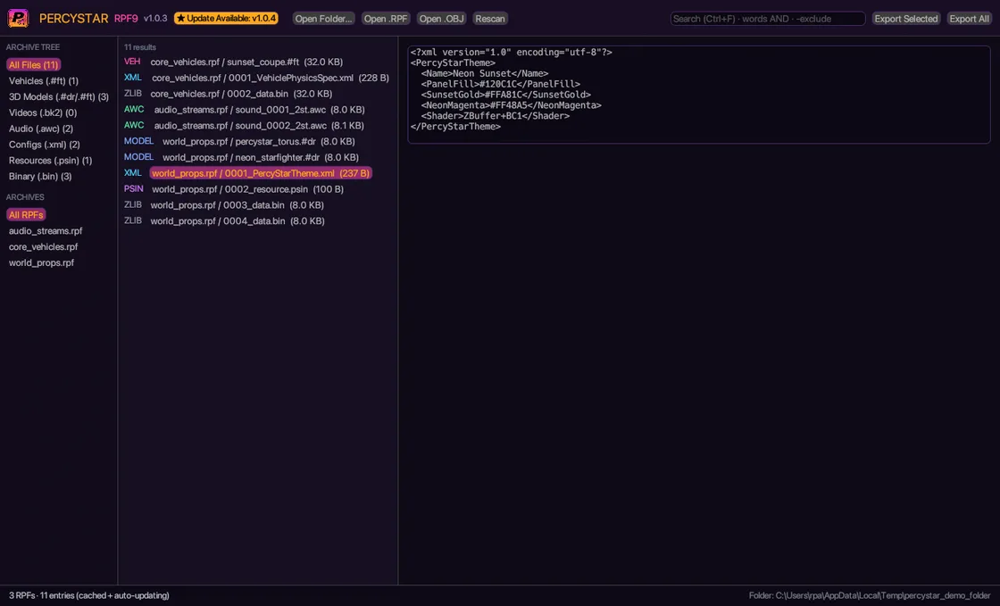
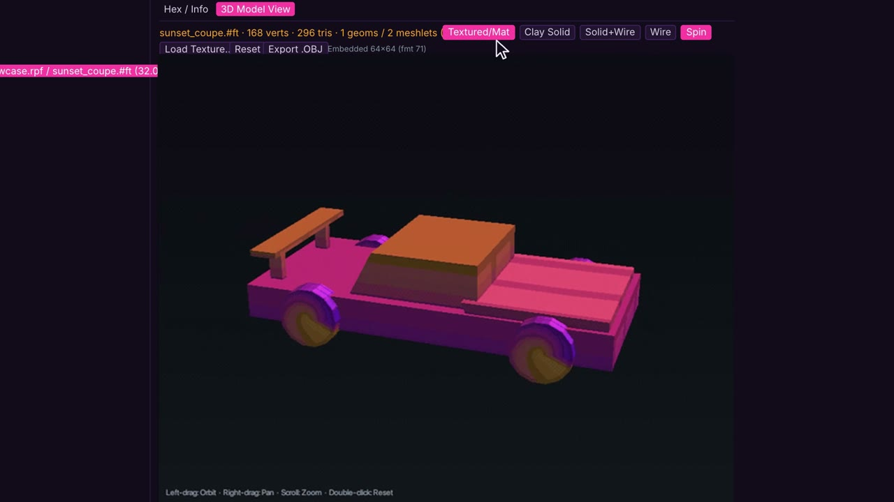
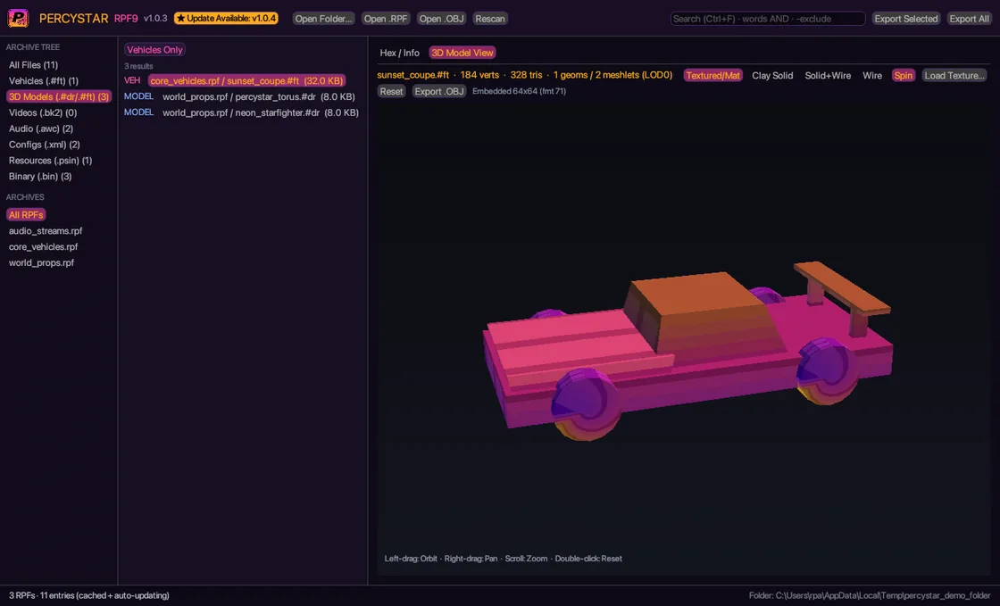
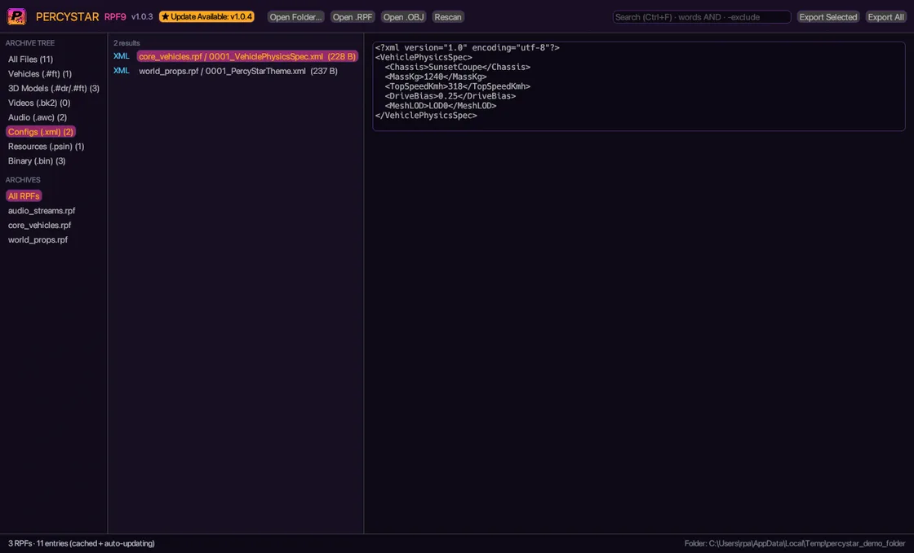
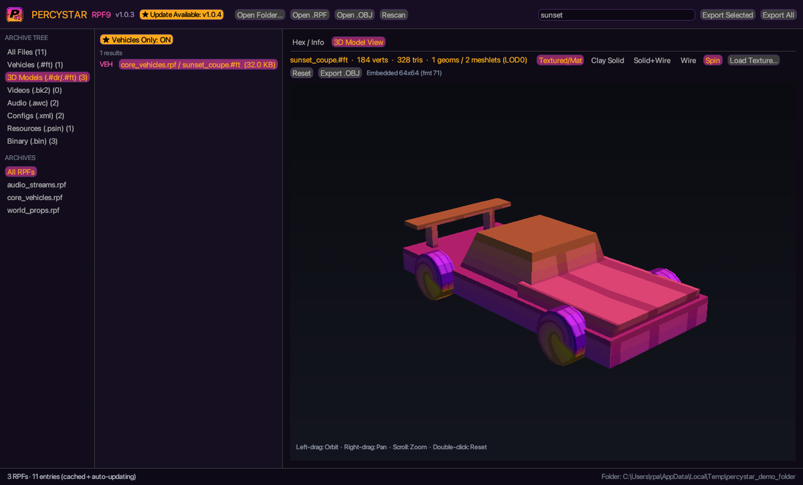

<p align="center">
  
</p>

<h1 align="center">PercyStar</h1>

<p align="center">
  <strong>Zero-dependency native Rust RPF9 (<code>9FPR</code>) &amp; TTPF (<code>RDS5</code>/<code>ETPF</code>) explorer — dedicated 10-category RAGE 9 3D Model Viewer, 100% Xbox Scarlett RDNA2 texture decoder (all 20 DXGI formats), native <code>0DRPz</code>/<code>RBF0</code>/<code>GFx</code> UI &amp; text decoders, <code>CNavMesh</code> 3D viewer, pure-Rust <code>ADAT</code> Opus audio, and docked D3D11 Bink2 player</strong>
</p>

<p align="center">
  
  
  
  
  
  
  
  
</p>

<p align="center">
  <strong>Latest Release: <a href="https://github.com/rpatty-dev/PercyStar/releases/latest">Download PercyStar v1.2.0 (Win64 + In-App Auto-Updater)</a></strong> · <strong><a href="https://github.com/rpatty-dev/PercyStar/releases/download/v1.0.3/PercyStar_macOS.zip">macOS Universal Build</a></strong><br />
  <strong>Live Research &amp; Breakthroughs Dashboard: <a href="https://percystar-breakthroughs.vercel.app">percystar-breakthroughs.vercel.app</a></strong> · <strong><a href="https://mapnavmeshsite.vercel.app">Interactive NavMesh World Map</a></strong><br />
  <sub>Windows users on v1.0.3+ can click the golden <b>★ Update Available</b> pill inside PercyStar for 1-click self-update.</sub>
</p>

<p align="center">
  
</p>

---

## Promo

<p align="center">
  <a href="assets/promo.mp4"></a><br />
  <sub><a href="assets/promo.mp4">Watch the 31-second promo (MP4)</a></sub>
</p>

---

## Visual Showcase

### RAGE 9 3D Meshlet Viewer (`Textured/Mat` · `Clay Solid` · `Solid+Wire` · `Wire`)
<p align="center">
  
</p>

### Pure-Rust Audio (`ADAT` Opus → WAV), `PSIN` Metadata & XML Inspector
<p align="center">
  
</p>

<details>
<summary>Static High-Res Screenshot (Neon Sunset v1.0.3)</summary>
<p align="center">
  
</p>
</details>

---

## Features & Format Breakthroughs (v1.2.0)

- **Dedicated 3D Model Viewer Tab (`Explorer | Model Viewer`)**
  - Full-screen 3D workspace built for instant 60 FPS browsing across **144,000+ RAGE 9 3D models**.
  - **10 Smart Auto-Categories** with live counts: **All Models**, **Vehicles**, **Air & Sea**, **Weapons**, **Characters**, **Clothing**, **Animals**, **Props & Items**, **World / Map**, and **NavMesh 3D**.
  - **Hide LODs** toggle (filters `_lod`/`_slod`/`_mid`), `◀ Prev` / `Next ▶` / `Random` buttons, `Up`/`Down` arrow-key browsing, **5 Camera Presets** (`3/4`, `Front`, `Side`, `Back`, `Top`), and **1-Click Catalog CSV Import** (`Import CSV...` / auto-detected local catalogs) + `.OBJ` loader.
- **100% Xbox Series X (Scarlett / RDNA2) Texture Engine (`.#td` & `.ttpf`)**
  - **100.00% TTPF Format Identification (357,115 / 357,115 textures):** Solved ETPF descriptor `u1` bits 3..9 (`(u1 >> 3) & 0x7F` = exact Microsoft `DXGI_FORMAT` enum) — zero unknown texture formats.
  - **All 20+ DXGI Formats Decoded Natively in Pure Rust:** `BC1`–`BC7`, `BC6H_UF16`/`SF16` HDR, `R16G16B16A16_FLOAT`/`UNORM`, `R16_FLOAT`/`UNORM`, `R16G16_FLOAT`, `R32_FLOAT`, `R10G10B10A2_UNORM`, `R8G8B8A8`, `B8G8R8A8`, `R8_UNORM`, `A8_UNORM` (`texture2ddecoder` + IEEE-754 half-float Reinhard tonemapping).
  - **Verified RDNA2 4KB (`SW_4KB_D`) & 64KB Deswizzle for All 5 Bit Depths (8 / 16 / 32 / 64 / 128bpp):** Plus reverse-mip `mip0` tail addressing, instant `O(log N)` RDS5 chunk seeking, exact RDS5 chunk codec decoding (`0=RAW`, `1..7=HW BCPack BC1..BC7`, `8=ZLIB`), interactive zoom viewer, multi-texture strip, and **Export PNG / Export DDS (DX10)**.
- **Expanded RAGE 9 3D Meshlet Decoder (`.#dr`, `.#ft`, `.#dd`, `.obj`)**
  - Direct click-to-view decoding of unencrypted RAGE 9 virtual (`0x50xxxxxx`) + physical (`0x60xxxxxx`) meshlet resources straight out of `.rpf` archives, including `+0xA8` drawable name resolution and non-zero page header support (**38× more models discovered**).
  - Clean **LOD0-only** extraction (`Lod0 -> grmModel -> grmGeometry`), 24/24/16-bit quantized vertices, 7-bit packed meshlet triangles + `u16` remap table, **UV0** (`type 0x28`), upgraded embedded `SW_4KB_D` BC7/BC3/BC1 textures, custom `.png`/`.bmp` texture loading, and full `.OBJ` export (`v` + `vt` + `f v/vt`).
- **Native UI, Localization & NavMesh Decoders (`RBF0`, `GFX`, `0DRPz`, `CNavMesh`)**
  - **`0DRPz` Text / GXT Viewer:** Decodes multi-chunk RAGE 9 UTF-8 localization tables & standalone string pools under **UI & Text (`RBF0/GFX/GXT`)** with searchable preview-slug filenames.
  - **`RBF0` (`fwui`) → XML:** Handles the 4-byte `0xFB 0xFF 0x01 0x00` header to decode binary UI resources cleanly into XML (with `.xml` export).
  - **Scaleform GFx v42 (AS3) Inspector:** Dumps ActionScript 3 classes, packages, and symbol references.
  - **`CNavMesh` (`0x00010015`) 3D Viewer:** Detects navigation tiles with world grid coordinates (`nav_{gx}_{gy}_(x,y).ynv`), triangulates polygons colored by surface type (land/water/road/pavement/interior), and exports `.OBJ`.
- **100% Native Runtime Dependencies for Audio, 3D, Textures, UI, XML & PSO**
  - **No Python, no FFmpeg, no external DLLs required** — `ADAT` (`.awc`) Opus streams decode natively via pure-Rust `rusty-opus` (RFC 6716). All crates pinned in [`Cargo.lock`](Cargo.lock).
- **Whole-Folder & Single-Archive Scanning (`.rpf` & `.ttpf`)**
  - Multi-threaded live scanning cached to `%LOCALAPPDATA%\PercyStar\scan_cache_v8.tsv`.
- **Docked D3D11 Bink2 Video Player (Optional `binkplay.exe`)**
  - Docks RAD `binkplay.exe` (`/NoBorder /DrawD3D11 /L`) directly into the inspector pane. Run [`scripts/setup_deps.ps1`](scripts/setup_deps.ps1) if needed.
- **CLI Batch Exporters (Models & Textures)**
  ```powershell
  PercyStar.exe --extract-vehicles "<path-to-levels.rpf>" "<output-dir>"
  PercyStar.exe --extract-models "<path-to-archive.rpf>" "<output-dir>" "filter1,filter2"
  PercyStar.exe --dump-textures "<path-to-archive.rpf|.ttpf>" "<output-dir>" [limit]
  ```

---

## Project Layout

```text
PercyStar/
├── assets/
│   ├── logo.png            # App & window icon
│   ├── logo.ico            # Windows executable icon
│   ├── demo_overview.webp  # 30fps Neon Sunset UI, search & updater showcase
│   ├── demo_3d.webp        # 30fps 3D meshlet viewer shading modes showcase
│   ├── demo_inspector.webp # 30fps XML / PSIN / ADAT Opus audio showcase
│   ├── preview.png         # High-res Neon Sunset screenshot
│   ├── promo.mp4           # 31s promo video
│   └── promo-poster.jpg    # Promo poster frame
├── promo/                  # HyperFrames source for the promo video
├── scripts/
│   ├── build_macos.sh      # Universal macOS (.app / .zip) build helper
│   ├── setup_deps.ps1      # Optional RAD Video Tools (binkplay.exe) setup
│   ├── awc_extract.py      # Standalone CLI ADAT (.awc) Opus -> .wav helper
│   └── rpf9_carve.py       # Standalone CLI RPF9 carver
├── src/
│   ├── main.rs             # PercyStar egui app, Model Viewer tab, RPF9/TTPF scanner & CLI
│   ├── model3d.rs          # RAGE 9 meshlet decoder, UV/TXD parser & Z-buffer renderer
│   ├── tex.rs              # Xbox Scarlett RDNA2 4KB/64KB textures, TTPF, RBF0, GFx, 0DRPz & CNavMesh
│   └── awc.rs              # Pure-Rust ADAT (.awc) Opus -> .wav decoder
├── app.rc / build.rs       # Win32 icon resource
├── Cargo.toml / Cargo.lock # All Rust crate dependencies pinned cleanly
└── LICENSE
```

---

## Building from Source

Requires **Rust** (`x86_64-pc-windows-gnu` with MinGW `windres`/`dlltool`, or `msvc`). Cargo fetches all pinned dependencies from `Cargo.lock`:

```powershell
cargo test --release
cargo build --release
```

Compiled standalone binary: `target/release/PercyStar.exe`.

---

## Scope, Clean-Room Research & Legal Notice

PercyStar is an **independent, clean-room binary inspection and parser tool** built from scratch in Rust. It only parses **unencrypted, user-supplied files** (`KB2*` streams, `ADAT` audio, plain `zlib` XML/PSIN containers, and standard uncompressed meshlet vertex/index blocks) for research and interoperability (cf. 17 U.S.C. § 1201(f)):

- **Zero Circumvention / Zero Keys:** Contains **no** decryption routines, encryption keys, hashes, DRM bypasses, or access-control workarounds. Encrypted data is skipped untouched.
- **Zero Proprietary Content:** Ships **no** third-party binaries, copyrighted models, textures, audio, shaders, or game assets. Users are solely responsible for supplying archives they legally own or are authorized to inspect.
- **Independent Trademark Disclaimer:** PercyStar is an independent open-source project and is not affiliated with, endorsed by, or sponsored by any game studio or publisher.

**Copyright (c) 2026 rpatty-dev — All Rights Reserved.**  
See [LICENSE](LICENSE). You may download, run, and fork this repository on GitHub for personal use/reference, **but you may not modify, alter, or redistribute modified versions of the code or binaries without explicit written permission.**
